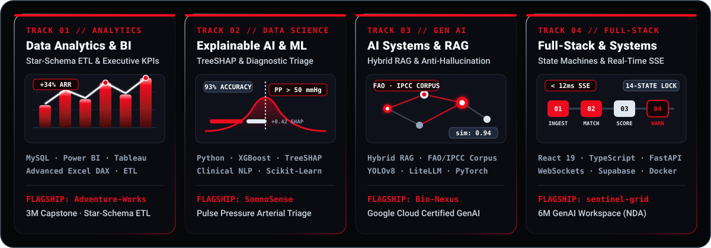
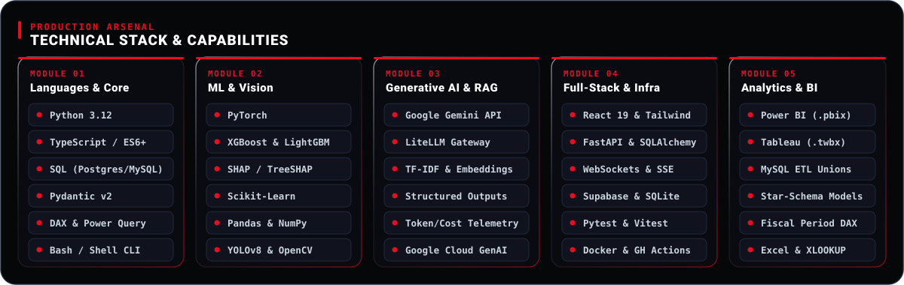

  

  &nbsp;
  &nbsp;
  &nbsp;
  

  

---

  

---

<h3 align="center">CONTRIBUTION MATRIX</h3>

  

---

### Featured Systems

<table>
  <tr>
    <td width="50%" valign="top">
      <h4><a href="https://github.com/MasterRohitPatil/sentinel-grid">sentinel-grid</a></h4>
      <b>AI Cyber Threat Early Warning &amp; Exposure Engine</b> 
      Deterministic CVE-to-asset exposure matcher eliminating alert fatigue. Features a 14-status closed-loop governance state machine, live attack simulation, and real-time SSE with WhatsApp alerting. 
      React · TypeScript · FastAPI · Supabase PostgreSQL · WebSockets
    </td>
    <td width="50%" valign="top">
      <h4><a href="https://github.com/MasterRohitPatil/Bio-Nexus">Bio-Nexus</a></h4>
      <b>Environmental Decision Intelligence &amp; Hybrid RAG</b> 
      Multi-variable ecological reasoning engine (soil × climate × land use) backed by a Hybrid RAG scientific layer (FAO, IPCC, IPBES) with strict anti-hallucination guardrails. 
      Python 3.12 · FastAPI · React 19 · SQLite · Pytest CI/CD
    </td>
  </tr>
  <tr>
    <td width="50%" valign="top">
      <h4><a href="https://github.com/MasterRohitPatil/somnosense">somnosense</a></h4>
      <b>Clinical Sleep Triage &amp; Cardiovascular Risk Platform</b> 
      3-class diagnostic triage (Healthy / Insomnia / Apnea) with 93% accuracy via XGBoost, per-patient local TreeSHAP attributions, and Pulse Pressure ($PP &gt; 50\text{ mmHg}$) arterial compliance monitoring. 
      Python · XGBoost · TreeSHAP · FastAPI · Clinical NLP
    </td>
    <td width="50%" valign="top">
      <h4><a href="https://github.com/MasterRohitPatil/Adventure-Works-Data-Analyst">Adventure-Works-Analytics</a></h4>
      <b>Enterprise Sales Analytics &amp; Star-Schema ETL</b> 
      Full dimensional modeling across MySQL, Power BI, Tableau, and Excel. Custom fiscal calendar periods, financial KPI derivations, and executive dashboard storytelling. 
      MySQL · Power BI · Tableau · Advanced Excel
    </td>
  </tr>
  <tr>
    <td width="50%" valign="top">
      <h4><a href="https://github.com/MasterRohitPatil/BlindAssistAi">BlindAssistAi</a></h4>
      <b>Real-Time Assistive Vision &amp; Audio Narration</b> 
      Edge-optimized computer vision for visually impaired users using YOLOv8n and zero-cloud pyttsx3 audio narration with desktop Tkinter GUI. 
      Python · YOLOv8 · OpenCV · pyttsx3 · Tkinter
    </td>
    <td width="50%" valign="top">
      <h4>Multi-LLM Workspace <i>(Private / NDA)</i></h4>
      <b>Enterprise Parallel LLM Orchestration &amp; Telemetry</b> 
      6-month internship system: simultaneous prompting across LLM providers, parallel response streaming panes, token diffs, and real-time latency/cost telemetry. 
      React 18 · TypeScript · FastAPI · WebSockets · LiteLLM · Docker
    </td>
  </tr>
</table>

---

### Industry Experience (10 Months Cumulative)

| Role | Domain / Organization | Duration | Focus &amp; Technical Impact |
| :--- | :--- | :---: | :--- |
| **Gen AI &amp; Full-Stack Intern** | Multi-LLM Workspace *(Under NDA)* | 6 Months | Parallel streaming interface, WebSocket state sync, and real-time token/cost telemetry using FastAPI &amp; React 18. |
| **Data Analytics &amp; BI Intern** | Adventure Works Capstone | 3 Months | Star-Schema dimensional data models, custom fiscal calendar logic, and executive Power BI / Tableau dashboards. |
| **Cloud &amp; Agentic AI Intern** | IBM Cloud Lite Services | 1 Month | Autonomous travel agent workflow architectures with cloud service integration. |

---

### Leadership &amp; Athletic Discipline

<table>
  <tr>
    <th width="50%" align="left">Institutional Leadership</th>
    <th width="50%" align="left">Endurance Athletics &amp; Discipline</th>
  </tr>
  <tr>
    <td valign="top">
      <ul>
        <li><b>TNP Stream Head (AIML):</b> Leading the Training &amp; Placement Cell for the AIML department, coordinating recruitment drives and student industry preparedness.</li>
        <li><b>Ex-GDG Blockchain Coordinator:</b> Served a full 1-year term coordinating technical workshops and decentralized tech sessions.</li>
        <li><b>Ex-CSI Publicity Coordinator:</b> Served a full 1-year term managing institutional visibility and event campaigns for Computer Society of India.</li>
      </ul>
    </td>
    <td valign="top">
      <ul>
        <li><b>Open-Water Sea Swimming:</b> Completed three open-ocean distance swims (<b>two 5KM</b> crossings and <b>one 3KM</b> swim).</li>
        <li><b>State-Level Triathlon:</b> Competed at the state level in multi-discipline swimming, cycling, and distance running.</li>
        <li><b>Karate (Golden Brown Belt):</b> Trained martial artist with podium participation across district and state-level tournaments.</li>
      </ul>
    </td>
  </tr>
</table>

---

### Honors &amp; Certifications

* **Google Cloud Certified:** Generative AI
* **State-Level Finalist:** Anveshna Science &amp; Engineering Project Competition
* **1st Runner-Up:** Eureka Technical Symposium
* **1st Runner-Up:** Cognition &amp; Vision-101
* **Fintech Innovation:** FinSight / Hisab-Hero *(Patent Pending)*

---

### Activity &amp; Telemetry

  &nbsp;
  

